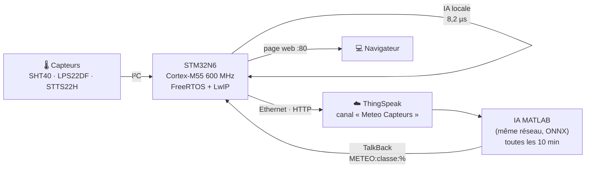

# 🌦️ IA Météo Edge

**Une carte électronique qui prédit la météo toute seule, en 8 microsecondes, même sans Internet.**

ETRS923 · USMB Master ESET · Aris Trache · NUCLEO-N657X0-Q (STM32N6) + X-NUCLEO-IKS4A1

---

## 1. En une phrase

La carte mesure **température, humidité, pression**. Une petite IA embarquée en déduit la météo du moment :
**Dégagé**, **Nuageux-Couvert** ou **Précipitations**. Elle envoie ses mesures au Cloud, où une 2ᵉ IA
(MATLAB) refait la prédiction. Puis la carte compare les deux avis.

| | |
|---|---|
| ⏱️ Temps d'une prédiction | **8,2 µs** (int8, accélération Helium du Cortex-M55) |
| 🚀 Gain d'optimisation | **×98** par rapport au code de départ (808 µs) |
| 🎯 Qualité du modèle | **F1 macro 0,606** · **7 pluies sur 10 détectées** |
| 🔋 Énergie (estimation) | 1 prédiction locale ≈ **2,5 µJ** contre ≈ 30–60 mJ pour 1 envoi au Cloud → **≈ 10 000× moins** |
| 📡 Sans Internet | l'IA continue, les mesures sont gardées puis renvoyées **avec leur date** |
| 🌐 Page web | servie **par la carte elle-même**, en direct |

---

## 2. Démo en 3 gestes

| Geste | Ce qu'on voit |
|---|---|
| 1. Ouvrir `http://192.168.137.xx` (adresse affichée dans la console) | le tableau de bord en direct, envoyé **par la puce**, sans serveur ni Internet |
| 2. **Souffler** sur le capteur | l'humidité grimpe au-dessus de 60 %, et l'IA passe à **« Précipitations »** en 2 s |
| 3. **Couper Internet** | badge rouge « Internet coupé · N mesures gardées ». L'IA continue ; au retour du réseau, rattrapage automatique |

Détails et tests : [docs/DEMO_EDGE.md](docs/DEMO_EDGE.md)

---

## 3. Architecture



| Brique | Rôle |
|---|---|
| **Carte capteurs** IKS4A1 | SHT40 (humidité + T), LPS22DF (pression), STTS22H (T de précision). Le pilote reconnaît aussi l'IKS01A3 |
| **STM32N6** | lit les capteurs toutes les 2 s, calcule les entrées, fait tourner l'IA, sert la page web |
| **FreeRTOS** | 4 tâches : capteurs + IA, réseau, serveur web, serveur echo |
| **LwIP** | DHCP, DNS, ping, client HTTP (ThingSpeak), serveur HTTP |
| **ThingSpeak + MATLAB** | IA Cloud de comparaison, avec un historique plus long |

---

## 4. L'IA en détail

### 4.1 Entrées : 14 nombres, tous mesurables par la carte

> Règle de départ : **aucune entrée que la carte ne peut pas produire** (pas de vent, de nuages ni de pluviomètre).

| # | Entrée | Type | Unité | D'où ça vient |
|---|---|---|---|---|
| 1 | Température | instantané | °C | SHT40 |
| 2 | Humidité relative | instantané | % | SHT40 |
| 3 | Pression niveau mer | instantané | hPa | LPS22DF + correction d'altitude (240 m) |
| 4 | Écart T − point de rosée | instantané | °C | calcul (formule de Magnus) |
| 5 | Δ pression sur 3 h | tendance | hPa | historique |
| 6 | Δ pression sur 1 h | tendance | hPa | historique |
| 7 | Δ température sur 3 h | tendance | °C | historique |
| 8 | Δ humidité sur 3 h | tendance | % | historique |
| 9 | Δ pression sur 6 h | historique 6 h | hPa | historique |
| 10 | Δ température sur 1 h | historique 6 h | °C | historique |
| 11 | Δ humidité sur 1 h | historique 6 h | % | historique |
| 12 | Humidité max sur 6 h | historique 6 h | % | historique |
| 13 | Humidité min sur 6 h | historique 6 h | % | historique |
| 14 | Écart de rosée moyen sur 6 h | historique 6 h | °C | historique |

L'historique est une mémoire circulaire de **6 moyennes horaires**. Les 14 entrées sont **normalisées** (moyenne/écart-type)
dans le code C, avec **le même code** testé contre Python (écart max 4,9·10⁻⁵ sur 588 valeurs).

### 4.2 Sortie : 3 classes

| Classe | Exemple |
|---|---|
| ☀️ Dégagé | ciel clair, beau temps |
| ☁️ Nuageux-Couvert | nuageux, couvert, brouillard |
| 🌧️ Précipitations | pluie, averses, neige, orage, grêle |

La sortie est une **probabilité par classe** (softmax), par exemple `Dégagé 19 % · Nuageux 56 % · Précipitations 25 %`.

### 4.3 Le réseau

```
14 entrées ──► 32 neurones (ReLU) ──► 16 neurones (ReLU) ──► 3 sorties (softmax)
                         1 059 paramètres · 5,4 Ko en int8
```

### 4.4 Les données

- **Meteostat**, données horaires 2017 → 2025, **6 stations du même climat** : Chambéry (à 3 km du campus), Lyon, Grenoble, Genève, Annecy, Montélimar.
- **359 637 heures** exploitables après nettoyage.
- Découpage **dans le temps** : entraînement 2017–2022, validation 2023, **test 2024–2025**.

---

## 5. Nos choix, et pourquoi

| Décision | Ce qu'on a choisi | Pourquoi |
|---|---|---|
| Nombre de classes | **3** | à 2 classes, le modèle fait *moins bien* que « toujours pas de pluie » (0,788 < 0,799) ; au-delà de 3, T/HR/P ne suffisent plus |
| Historique | **6 h** | effet baromètre : la *variation* de pression annonce la pluie (+0,05 de F1). Avec 24 h on gagne +0,008 seulement, et il faut 24 h d'attente après chaque redémarrage |
| Taille du réseau | **32-16** | le score plafonne : ×3 ou ×12 de paramètres pour +0,003. Il bat aussi le gradient boosting (0,575) |
| Démarrage à froid | **15 %** d'exemples sans historique à l'entraînement | sans ça, le modèle est mauvais les premières heures (+0,018 au démarrage, −0,006 en régime établi) |
| Métrique | **F1 macro** | l'accuracy récompense un modèle qui répond toujours « nuageux » |
| Compromis pluie | **rappel 0,69**, précision 0,49 | pour une station météo, mieux vaut une fausse alerte qu'une pluie ratée |
| Format embarqué | **int8 CMSIS-NN** | 8,2 µs au lieu de 14,7 µs en float32, et **100 % de décisions identiques** sur la carte |
| CPU ou NPU ? | **CPU + Helium** | testé sur le NPU Neural-ART : mêmes décisions mais **57 µs**. Sur un réseau aussi petit, le coût fixe du NPU dépasse le calcul. Le NPU est validé et prêt pour un futur modèle plus gros → [docs/TP3_NPU.md](docs/TP3_NPU.md) |
| Réseau | **Ethernet + LwIP + FreeRTOS** portés à la main | CubeMX ne les propose pas pour le projet FSBL du STM32N6 |
| Cloud | **ThingSpeak + MATLAB** | gratuit, analyse MATLAB intégrée, TalkBack pour répondre à la carte |
| Coupure réseau | **mémoire de 30 min** + renvoi daté | une station météo ne doit rien perdre. L'heure est lue dans les réponses ThingSpeak, sans horloge temps réel |
| Visualisation | **page web servie par la carte** | démonstration sans Internet ni logiciel à installer |

---

## 6. Ce qu'on redoutait, et ce qu'on a fait

| Risque | Ce qui pouvait mal tourner | Parade |
|---|---|---|
| 🎭 Score gonflé | découpage aléatoire : deux heures voisines en entraînement ET en test | découpage **par années** |
| 📏 Pression décalée | le capteur mesure la pression **absolue** (~985 hPa), Meteostat donne celle **au niveau de la mer** (~1013 hPa) | correction d'altitude sur la carte, sinon 28 hPa d'erreur |
| 🥶 Carte « amnésique » | aucun historique au démarrage | entraînement avec 15 % d'exemples sans historique |
| 🔢 Perte en int8 | les poids compressés changent les décisions | contrôle : 0 octet différent entre CMSIS-NN et TFLite (400 vecteurs), 100 % d'accord sur la carte |
| 🧩 Code C ≠ Python | une entrée mal calculée = une IA fausse | tests automatiques de parité (`firmware/tests_hote/`) |
| 🐢 NPU « magique » | croire que le NPU accélère tout | **mesuré** : 57 µs contre 8,2 µs sur CPU, donc choix argumenté |
| 🌐 Pas de FreeRTOS/LwIP dans CubeMX | réseau impossible à générer | portage manuel en reprenant l'exemple officiel ST |
| 🐞 DHCP muet | l'interface réseau n'était pas « up » | `netif_set_up()` avant `dhcp_start()` |
| 🔑 Fuite de clé | clé ThingSpeak poussée sur GitHub | fichier `secrets_thingspeak.h` **ignoré par git**, exemple neutre versionné |
| 📴 Internet coupé en démo | perte de données, démo cassée | mode hors ligne + rattrapage, **testé** |

---

## 7. Limites honnêtes

- **F1 0,606** : on prédit une tendance, pas le bulletin de Météo-France.
- Distinguer « dégagé » de « nuageux » sans **capteur de lumière** reste difficile. Ce serait l'ajout matériel le plus rentable.
- La consommation est **estimée** à partir des datasheets, pas encore mesurée → protocole dans [docs/CONSOMMATION.md](docs/CONSOMMATION.md).
- Programme en RAM (mode de démarrage de développement) : on relance la carte par Debug, pas par RESET.

---

## 8. Démarrage rapide

1. **Entraîner / rejouer** : ouvrir `notebooks/TP3_Meteostat_IA.ipynb` dans Colab (le dépôt est cloné automatiquement).
2. **Carte** : importer `firmware/TP2_Capteurs` dans STM32CubeIDE. Dans `main.c`, `TP2_PARTIE` vaut
   1 = chenillard, 2 = capteurs, 3 = IA météo, **4 = IA + FreeRTOS/LwIP/Ethernet** (démo).
3. **Cavaliers** : BOOT0 = JP1 en 1-2, BOOT1 = JP2 en 2-3.
4. **Réseau** : câble Ethernet carte ↔ PC + **partage de connexion Windows** (le PC donne une adresse 192.168.137.x à la carte).
5. **Clé ThingSpeak** : copier `FSBL/Core/Inc/secrets_thingspeak_exemple.h` en `secrets_thingspeak.h` et y mettre la clé.
6. **Lancer** : Debug (**F11**) puis Resume (**F8**). Console COM 115200 bauds. Ouvrir l'adresse affichée par `<Serveur web>`.

---

## 9. Arborescence

| Dossier | Contenu |
|---|---|
| `notebooks/` | TP1 (MNIST) et TP3 (Meteostat) : entraînement Python/TensorFlow sur Colab |
| `firmware/` | projet STM32CubeIDE : capteurs, IA (float, int8, NPU), FreeRTOS, LwIP, page web |
| `firmware/tests_hote/` | tests du code C sur PC (parité C/Python, pilote capteurs simulé) |
| `matlab/` | scripts ThingSpeak : IA Cloud et TalkBack |
| `models/` | modèles exportés (.keras, .onnx, .tflite int8) |
| `tools/` | générateurs : notebook, export C, compilation NPU (`tools/npu/`) |
| `data/` | script de récupération Meteostat |
| `docs/` | résultats, consommation, NPU, démo, déclaration IA |

---

## 10. Avancement

- [x] **TP1** : MNIST (activations, optimiseurs, fonctions de coût) → [résultats](docs/TP1_RESULTATS.md)
- [x] **TP2** : LEDs, logs UART, capteurs I²C (IKS4A1 et IKS01A3 détectées automatiquement)
- [x] **TP2.3** : FreeRTOS + LwIP : DHCP, DNS, ping, serveur echo, envoi ThingSpeak → [résultats](docs/TP2_RESULTATS.md)
- [x] **TP3** : modèle Meteostat, 3 classes, F1 0,606 → [résultats](docs/TP3_RESULTATS.md)
- [x] **TP3** : IA embarquée : float32 14,7 µs, **int8 8,2 µs**, NPU 57 µs → [NPU](docs/TP3_NPU.md)
- [x] **TP3** : boucle Edge ↔ Cloud complète (ThingSpeak + MATLAB + TalkBack)
- [x] **TP3** : consommation : estimation + protocole → [document](docs/CONSOMMATION.md)
- [x] **Démo** : page web dans la carte, mode hors ligne, test du souffle → [détails](docs/DEMO_EDGE.md)
- [ ] **TP4** : pitch de 3 min

---

## Usage de l'IA

Projet réalisé avec l'aide de Claude (Anthropic), dans le cadre de la charte IA de l'USMB.
Chaque code a été relu, compilé et testé sur la carte par l'auteur → [docs/DECLARATION_IA.md](docs/DECLARATION_IA.md)

Données météo : Meteostat, licence CC BY-NC 4.0.
