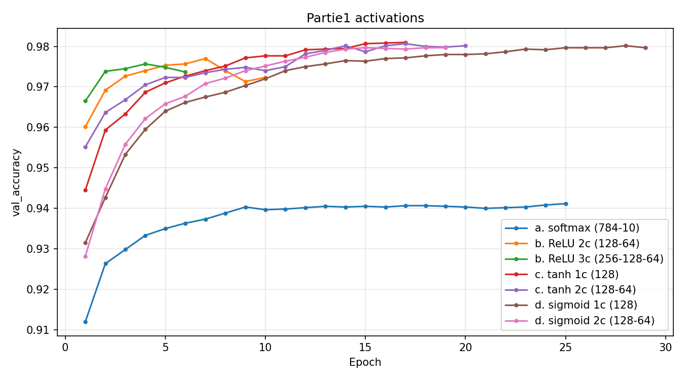
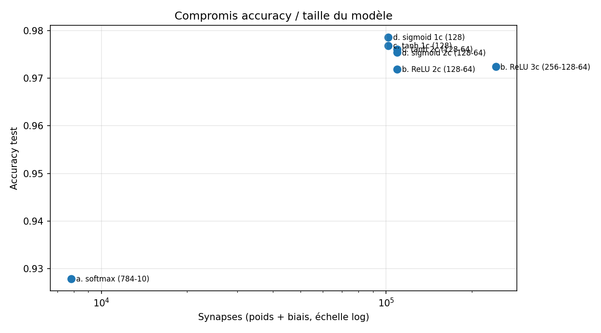
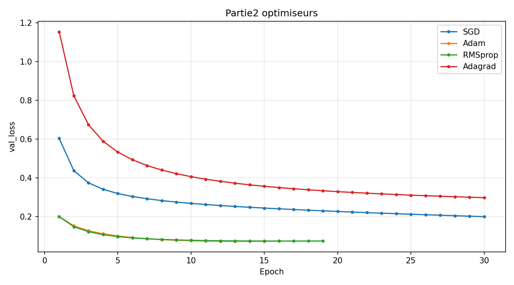

# TP1 — MNIST : résultats et choix justifiés

Notebook : [`notebooks/TP1_MNIST_MLP.ipynb`](../notebooks/TP1_MNIST_MLP.ipynb) · Exécution : Google Colab, GPU T4, TensorFlow 2.21
Protocole commun : 54 000 images d'entraînement / 6 000 de validation / 10 000 de test, batch 128, 30 epochs max, EarlyStopping (patience 3 sur `val_loss`, meilleurs poids restaurés), graine 42.
Synapses = poids + biais (même définition que `count_neurons_and_synapses` du cours).

## Choix final

| Élément | Choix | Raison principale |
|---|---|---|
| Architecture | **784 → 128 (tanh) → 10 (softmax)** | Meilleur compromis précision / taille : 97,8 % pour 101 770 synapses |
| Optimiseur | **Adam** | Converge le plus vite (13 epochs), précision équivalente à RMSprop |
| Coût (entraînement) | **categorical_crossentropy** | Meilleure accuracy mesurée ; écarts entre variantes dans le bruit |
| Sortie (déploiement) | **logits, sans softmax** | Même décision prouvée (`argmax` identique) et un calcul d'exponentielles en moins sur MCU |

**Modèle final** : [`models/mnist_mlp_tanh128_acc0.9781.keras`](../models/mnist_mlp_tanh128_acc0.9781.keras) — accuracy test **97,81 %**, 101 770 synapses, **397,5 Ko en float32 / 99,4 Ko en int8**.

## Mesure du bruit expérimental (point de méthode)
La même configuration (tanh 1c + Adam + categorical) a été entraînée **4 fois** au cours du TP : 97,68 % · 97,59 % · 97,66 % · 97,81 %.
L'écart d'un entraînement à l'autre est donc d'environ **±0,1 point** (non-déterminisme du GPU). **Toute différence inférieure à ~0,2 point n'est pas significative** : elle ne doit pas décider d'un choix à elle seule. Les choix ci-dessous en tiennent compte.

## Partie 1 — Fonction d'activation (Adam + categorical_crossentropy)

| Modèle | Accuracy | Epochs | Synapses | Float32 | Int8 |
|---|---|---|---|---|---|
| a. softmax (784-10) | 92,79 % | 22 | 7 850 | 30,7 Ko | 7,7 Ko |
| b. ReLU 2c (128-64) | 97,19 % | 7 | 109 386 | 427,3 Ko | 106,8 Ko |
| b. ReLU 3c (256-128-64) | 97,24 % | 3 | 242 762 | 948,3 Ko | 237,1 Ko |
| **c. tanh 1c (128)** | **97,68 %** | **14** | **101 770** | **397,5 Ko** | **99,4 Ko** |
| c. tanh 2c (128-64) | 97,61 % | 17 | 109 386 | 427,3 Ko | 106,8 Ko |
| d. sigmoid 1c (128) | 97,86 % | 26 | 101 770 | 397,5 Ko | 99,4 Ko |
| d. sigmoid 2c (128-64) | 97,54 % | 16 | 109 386 | 427,3 Ko | 106,8 Ko |

**Analyse**
- **Softmax seule = modèle linéaire** : elle plafonne à 92,8 %. Ajouter une couche cachée de 128 neurones fait gagner **5 points** pour 13× plus de synapses. C'est le gain le plus rentable de toute l'étude.
- **Aller plus profond ne sert à rien ici** : ReLU 3c a 2,4× plus de synapses que tanh 1c et fait **moins bien**. Il atteint son optimum dès l'epoch 3, puis la `val_loss` remonte : le modèle **sur-apprend** (trop de paramètres pour la tâche). Les versions 2 couches de tanh et sigmoid sont aussi moins bonnes que leur version 1 couche.
- **Vitesse de convergence** : ReLU (3–7 epochs) > tanh (14) > sigmoid (26). La sigmoïde sature (dérivée ≤ 0,25 et proche de 0 aux extrêmes) et sa sortie n'est pas centrée sur 0, ce qui ralentit la descente de gradient. tanh est centrée sur 0 avec une dérivée max de 1.

**Pourquoi tanh 1c (128)**
1. **Pareto-optimal** : aucun autre modèle n'est à la fois plus petit et plus précis. Seule sigmoid 1c, de taille identique, fait +0,18 point, ce qui est **dans le bruit** (±0,1 point mesuré, et la réexécution finale de tanh 1c donne 97,81 %, à égalité).
2. **Deux fois moins d'epochs que sigmoid** (14 contre 26) : entraînement plus court, donc moins d'énergie consommée côté PC/Cloud (critère P_TEDS).
3. **Le plus petit des modèles performants** : 99,4 Ko en int8, c'est-à-dire **~19 % de la Flash de 512 Ko** de la NUCLEO-N657X0. Il reste de la place pour le firmware, FreeRTOS et LwIP.
4. *Limite connue* : sur MCU, tanh coûte plus cher à calculer que ReLU (`max(0,x)`). Ici, ReLU coûte 0,5 point et 7 % de synapses en plus, donc le compromis penche vers tanh. En int8, X-CUBE-AI traite tanh par table de correspondance, ce qui limite ce surcoût.

## Partie 2 — Optimiseur (architecture tanh 1c)

| Optimiseur | Accuracy | Epochs | Temps |
|---|---|---|---|
| SGD (lr 0,01) | 93,59 % | 30 (non convergé) | 39 s |
| **Adam (lr 0,001)** | **97,59 %** | **13** | **24 s** |
| RMSprop (lr 0,001) | 97,74 % | 16 | 26 s |
| Adagrad (lr 0,001) | 90,88 % | 30 (non convergé) | 41 s |

**Analyse**
- **SGD et Adagrad n'ont pas convergé** : ils atteignent le plafond de 30 epochs avec une `val_loss` encore en baisse. Ils ne sont pas mauvais en soi, ils sont **lents avec leur pas par défaut**. Adagrad est le plus lent car son taux d'apprentissage effectif ne fait que **décroître** (accumulation des gradients au carré).
- **Adam et RMSprop adaptent le pas à chaque paramètre** et convergent en moins de 20 epochs.

**Pourquoi Adam** : RMSprop fait +0,15 point (dans le bruit) mais demande **3 epochs de plus**. Adam combine momentum et RMSprop, c'est l'optimiseur le plus robuste sans réglage : il est réutilisable tel quel pour le modèle Meteostat du TP3. L'optimiseur **ne change pas la taille du modèle embarqué**, uniquement le coût de l'entraînement.

## Partie 3 — Fonction coût (tanh 1c + Adam)

| Variante | Sortie | Labels | Accuracy | Epochs |
|---|---|---|---|---|
| **categorical_crossentropy** | softmax (10) | one-hot | **97,66 %** | 13 |
| sparse_categorical_crossentropy | softmax (10) | entiers | 97,48 % | 14 |
| sparse + `from_logits=True` | linéaire (10) | entiers | 97,42 % | 16 |
| binary_crossentropy *(pair / impair)* | sigmoid (1) | 0 / 1 | 98,57 % | 10 |

**Analyse**
- Les trois variantes multi-classes sont **mathématiquement le même problème** (entropie croisée sur 10 classes) : les écarts (≤ 0,24 point) sont du bruit d'entraînement, pas un effet de la fonction coût.
- `sparse` évite de stocker les labels en one-hot (10 valeurs par image au lieu d'une).
- La version **binaire** ne se compare pas aux autres : c'est un autre problème (2 classes au lieu de 10), donc plus facile. Elle montre comment adapter la sortie (1 neurone sigmoid) et le coût à un problème binaire.
- **Preuve exécutée** : sur 1 000 images de test, `argmax(logits) == argmax(softmax(logits))` donne **True**. Le softmax est strictement croissant, donc il ne change pas la classe prédite.

**Pourquoi ce choix**
- **Entraînement** : `categorical_crossentropy`, la meilleure accuracy mesurée, et la consigne du TP pour la Partie 1.
- **Déploiement** : **retirer le softmax** à l'inférence et prendre l'`argmax` des logits. C'est la même décision (prouvé ci-dessus), avec 10 exponentielles et une division en moins par inférence sur le microcontrôleur, donc moins de latence et moins d'énergie.

## Lien avec la suite (TP3 embarqué)
- La quantification **int8 divise la mémoire par 4** (397,5 → 99,4 Ko). C'est ce qui rend le déploiement X-CUBE-AI confortable sur la N657.
- La méthode (protocole fixe, mesure du bruit, critère précision / taille / epochs) sera réutilisée telle quelle pour le modèle Meteostat.

---
*Usage de l'IA déclaré dans [`DECLARATION_IA.md`](DECLARATION_IA.md).*
